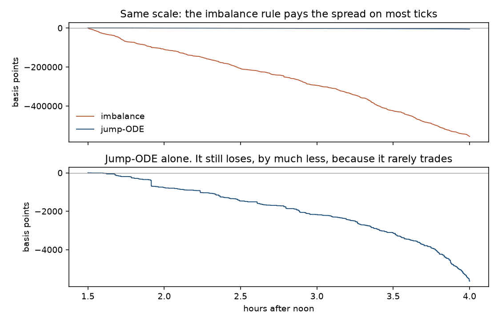
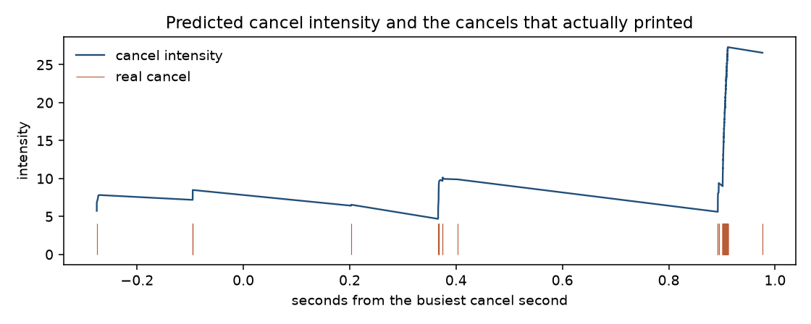

# Which way the price moves in the next fraction of a second

Orders in a book do not arrive as a smooth stream. They arrive in jerks. Between two events nothing happens. At an event the state of the market jumps: someone places an order, cancels one, or a trade prints.

The model lives on that same clock. Between ticks a hidden state drifts. On a tick it jumps. From the state after the jump it says whether the microprice will be up, down, or flat at 50, 100, and 250 milliseconds. It does not read future ticks to do that.

Separately, it estimates how dense the next stream of events will be. That is an intensity: not “what will happen,” but “how often this kind of thing happens.” For cancellations, the intensity barely separates a burst of cancels from an ordinary second.

The data is one day of one stock, Amazon, 21 June 2012, a LOBSTER feed. This is a reading of an old public tape. It is not a trading result.

## The model can tell the sign

On the afternoon, which the network did not see during training, and only on the rows where the price actually moved:

| Horizon | Moves | AUC |
| --- | --- | --- |
| 50 ms | 8,072 | 0.760 |
| 100 ms | 9,504 | 0.756 |
| 250 ms | 11,648 | 0.732 |

An AUC of 0.5 is a coin flip. The requested limit was 0.65. It is met at 50 ms and at 250 ms. Most rows are still flat: the price sits more often than it moves. The model trades on about 1% of ticks.

The check that it does not look into the future also passes. If the tape after time i is corrupted, the answer up to that time does not change.

## Money after the spread

Guessing the direction is not enough. To make money as a taker, the trade has to pay the whole spread plus 0.5 basis points of fee. The spread that day was about 5 basis points. One tick does not cover it.

On the top panel both strategies share one scale. The rule “trade when the book is lopsided” pays the spread on almost every tick and ends at −556 thousand basis points. On that scale the model lies almost on zero. The bottom panel is the model alone. It is also down, by about −5,600 basis points over the half day. The loss is smaller because it rarely enters a trade.



The information ratio, the mean divided by the scatter of one-second bins, is about −0.15 at 50 ms and −0.12 at 250 ms. The sign is negative, and it barely changes between a delay of 1 microsecond, 1 millisecond, or 5 milliseconds.

A maker queue is not modeled. A LOBSTER row does not say where we stand in line, so a fill is not invented.

## Cancellation intensity

The blue line is how strongly the model expects a cancel. The orange ticks are cancels that actually printed. The line rises at the burst on the right and does not fall to zero between bursts. On average, the intensity just before a cancel is only 3% higher: 8.84 versus 8.56. The head is alive. It does not separate a cascade.



## Run

The tape files are not in the repository.

```bash
python3.12 -m venv .venv
source .venv/bin/activate
pip install -r requirements.txt
python -m unittest discover -s tests -t .
python -m src.train --no-ablation --epochs 2
```

The table is `runs/metrics.json`. Fees and delay are computed in `src/latency_simulator.py`.
